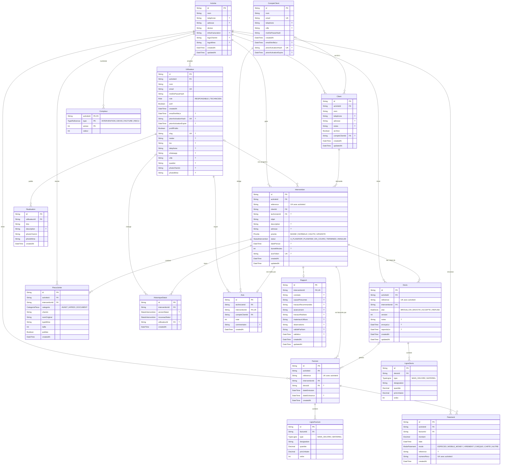

# Schéma de la base de données

Base PostgreSQL gérée avec Prisma. Source : [`backend/prisma/schema.prisma`](../backend/prisma/schema.prisma).

Légende : **PK** = clé primaire, **FK** = clé étrangère, **UK** = valeur unique, `?` = champ facultatif.

## Diagramme

## Description des tables

### Activite
L'entreprise (ou l'artisan) qui utilise l'application. Presque toutes les données y sont rattachées, ce qui isole les données de chaque activité.

| Colonne | Description |
|---|---|
| `id` | Identifiant unique (UUID) |
| `nom` | Nom de l'activité |
| `telephone`, `adresse` | Coordonnées |
| `devise` | Devise utilisée pour les montants (ex. XAF) |
| `infosFacturation` | Mentions affichées sur les devis et factures |
| `logoChemin`, `logoMime` | Fichier du logo et son type |
| `createdAt`, `updatedAt` | Dates de création et de modification |

### Utilisateur
Personne qui se connecte côté professionnel : responsable ou technicien. Peut aussi avoir un profil public visible dans l'annuaire.

| Colonne | Description |
|---|---|
| `id` | Identifiant unique |
| `activiteId` | Activité à laquelle il appartient |
| `nom`, `email` | Nom et e-mail de connexion (unique) |
| `motDePasseHash` | Mot de passe chiffré |
| `role` | `RESPONSABLE` ou `TECHNICIEN` |
| `actif` | Compte activé ou désactivé |
| `emailVerifieLe` | Date de validation de l'e-mail (vide tant que non validé) |
| `jetonActivationHash`, `jetonActivationExpire` | Jeton du lien d'activation et sa date d'expiration |
| `profilPublic` | Affiche ou non le profil dans l'annuaire public |
| `slug` | Identifiant lisible dans l'URL du profil public |
| `metier`, `bio` | Métier et présentation |
| `telephone`, `whatsapp` | Contacts |
| `ville`, `quartier` | Localisation |
| `photoChemin`, `photoMime` | Photo de profil |
| `createdAt` | Date de création |

### Realisation
Photo d'un travail déjà réalisé, affichée sur le profil public d'un technicien (portfolio).

| Colonne | Description |
|---|---|
| `id` | Identifiant unique |
| `utilisateurId` | Technicien auteur |
| `titre`, `description` | Titre et description du travail |
| `photoChemin`, `photoMime` | Photo du travail |
| `createdAt` | Date d'ajout |

### Compteur
Sert à générer les numéros de référence séquentiels (ex. `FAC-2026-0001`) par activité, par type de document et par année.

| Colonne | Description |
|---|---|
| `activiteId` | Activité concernée |
| `type` | `INTERVENTION`, `DEVIS`, `FACTURE` ou `RECU` |
| `annee` | Année du compteur |
| `valeur` | Dernier numéro attribué |

La clé primaire est le trio (`activiteId`, `type`, `annee`).

### Client
Client d'une activité (particulier ou entreprise) pour qui les interventions sont réalisées.

| Colonne | Description |
|---|---|
| `id` | Identifiant unique |
| `activiteId` | Activité propriétaire |
| `nom`, `telephone`, `adresse` | Coordonnées du client |
| `notes` | Remarques internes |
| `archive` | Client archivé (masqué des listes) |
| `compteClientId` | Lien facultatif vers le compte en ligne du client |
| `createdAt`, `updatedAt` | Dates de création et de modification |

### Intervention
Mission de travail chez un client. C'est la table centrale : devis, factures, rapport, photos et avis s'y rattachent.

| Colonne | Description |
|---|---|
| `id` | Identifiant unique |
| `activiteId` | Activité concernée |
| `reference` | Numéro lisible, unique dans l'activité |
| `clientId` | Client concerné |
| `technicienId` | Technicien assigné (facultatif) |
| `objet`, `description` | Motif et détail de l'intervention |
| `adresse` | Lieu de l'intervention |
| `priorite` | `BASSE`, `NORMALE`, `HAUTE` ou `URGENTE` |
| `statut` | `A_PLANIFIER`, `PLANIFIEE`, `EN_COURS`, `TERMINEE` ou `ANNULEE` |
| `datePrevue`, `dureeMinutes` | Date planifiée et durée estimée |
| `avisToken` | Jeton unique envoyé au client pour laisser un avis |
| `createdAt`, `updatedAt` | Dates de création et de modification |

### HistoriqueStatut
Journal des changements de statut d'une intervention (qui a changé quoi, et quand).

| Colonne | Description |
|---|---|
| `id` | Identifiant unique |
| `interventionId` | Intervention concernée |
| `ancienStatut` | Statut précédent (vide à la création) |
| `nouveauStatut` | Nouveau statut |
| `utilisateurId` | Auteur du changement |
| `createdAt` | Date du changement |

### Rapport
Compte rendu technique d'une intervention (un seul rapport par intervention).

| Colonne | Description |
|---|---|
| `id` | Identifiant unique |
| `interventionId` | Intervention concernée (unique) |
| `constats` | Ce qui a été observé sur place |
| `causePresumee` | Cause probable du problème |
| `travauxRecommandes` | Travaux conseillés |
| `avancement` | État d'avancement |
| `travauxRealises` | Travaux effectués |
| `materiauxUtilises` | Matériel utilisé |
| `observations` | Remarques complémentaires |
| `valideParNom`, `valideLe` | Nom de la personne qui valide et date de validation |
| `createdAt`, `updatedAt` | Dates de création et de modification |

### PieceJointe
Fichier joint à une intervention : photo avant/après travaux ou document.

| Colonne | Description |
|---|---|
| `id` | Identifiant unique |
| `activiteId`, `interventionId` | Activité et intervention concernées |
| `categorie` | `AVANT`, `APRES` ou `DOCUMENT` |
| `chemin` | Emplacement du fichier stocké |
| `nomOriginal`, `typeMime`, `taille` | Nom, type et taille du fichier |
| `publiee` | Visible publiquement (ex. sur le profil) |
| `createdAt` | Date d'ajout |

### Devis
Proposition de prix envoyée au client pour une intervention.

| Colonne | Description |
|---|---|
| `id` | Identifiant unique |
| `activiteId` | Activité émettrice |
| `reference` | Numéro du devis, unique dans l'activité |
| `interventionId` | Intervention concernée |
| `etat` | `BROUILLON`, `ENVOYE`, `ACCEPTE` ou `REFUSE` |
| `version` | Numéro de version du devis |
| `notes` | Remarques |
| `envoyeLe`, `reponduLe` | Dates d'envoi et de réponse du client |
| `createdAt`, `updatedAt` | Dates de création et de modification |

### LigneDevis
Une ligne de prix d'un devis.

| Colonne | Description |
|---|---|
| `id` | Identifiant unique |
| `devisId` | Devis parent |
| `type` | `MAIN_OEUVRE` ou `MATERIEL` |
| `designation` | Libellé de la ligne |
| `quantite`, `prixUnitaire` | Quantité et prix unitaire (total = quantité × prix) |
| `ordre` | Position d'affichage |

### Facture
Document de facturation d'une intervention, éventuellement créé à partir d'un devis accepté.

| Colonne | Description |
|---|---|
| `id` | Identifiant unique |
| `activiteId` | Activité émettrice |
| `reference` | Numéro de facture, unique dans l'activité |
| `interventionId` | Intervention facturée |
| `devisId` | Devis d'origine (facultatif) |
| `dateEmission`, `dateEcheance` | Date d'émission et date limite de paiement |
| `createdAt` | Date de création |

### LigneFacture
Une ligne de prix d'une facture (même structure que `LigneDevis`).

| Colonne | Description |
|---|---|
| `id` | Identifiant unique |
| `factureId` | Facture parente |
| `type` | `MAIN_OEUVRE` ou `MATERIEL` |
| `designation` | Libellé de la ligne |
| `quantite`, `prixUnitaire` | Quantité et prix unitaire |
| `ordre` | Position d'affichage |

### Paiement
Règlement (total ou partiel) d'une facture. Chaque paiement génère un reçu numéroté.

| Colonne | Description |
|---|---|
| `id` | Identifiant unique |
| `activiteId` | Activité qui encaisse |
| `factureId` | Facture réglée |
| `montant` | Montant payé |
| `date` | Date du paiement |
| `mode` | `ESPECES`, `MOBILE_MONEY`, `VIREMENT`, `CHEQUE`, `CARTE` ou `AUTRE` |
| `reference` | Référence de transaction (facultative) |
| `numeroRecu` | Numéro du reçu (ex. `REC-2026-0001`), unique dans l'activité |
| `createdAt` | Date d'enregistrement |

### CompteClient
Compte en ligne d'un client final, indépendant d'une activité : il permet de suivre ses interventions et de laisser des avis.

| Colonne | Description |
|---|---|
| `id` | Identifiant unique |
| `nom`, `email` | Nom et e-mail de connexion (unique) |
| `telephone`, `ville` | Contact et localisation |
| `motDePasseHash` | Mot de passe chiffré |
| `emailVerifieLe` | Date de validation de l'e-mail |
| `jetonActivationHash`, `jetonActivationExpire` | Jeton du lien d'activation et sa date d'expiration |
| `createdAt` | Date de création |

### Avis
Note et commentaire laissés par un client sur un technicien après une intervention (un seul avis par intervention).

| Colonne | Description |
|---|---|
| `id` | Identifiant unique |
| `technicienId` | Technicien évalué |
| `interventionId` | Intervention concernée (unique) |
| `compteClientId` | Client auteur de l'avis |
| `note` | Note attribuée |
| `commentaire` | Commentaire libre |
| `createdAt` | Date de l'avis |
